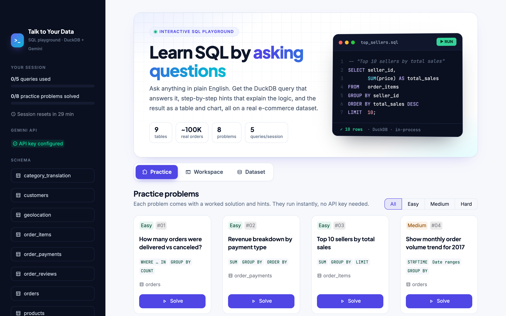
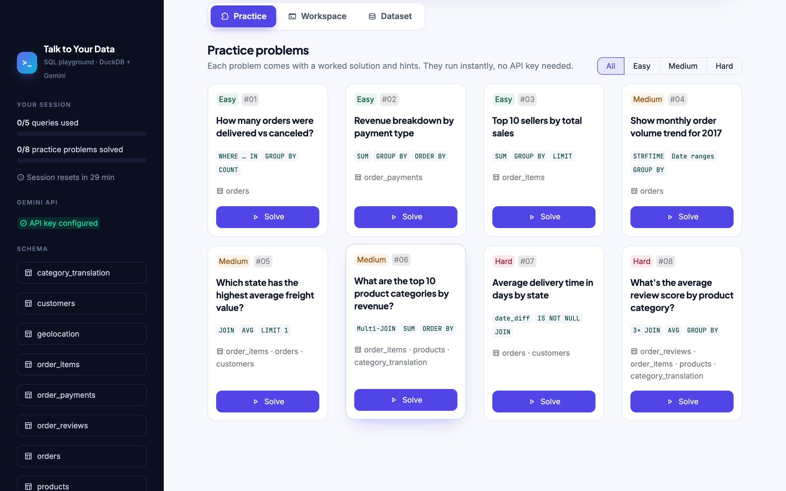
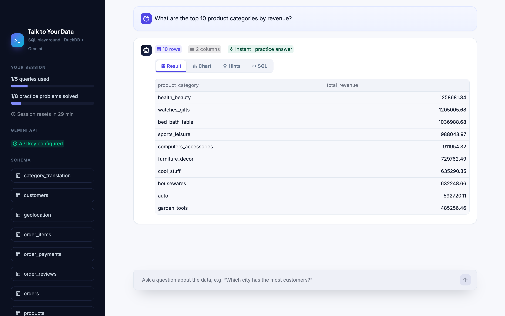
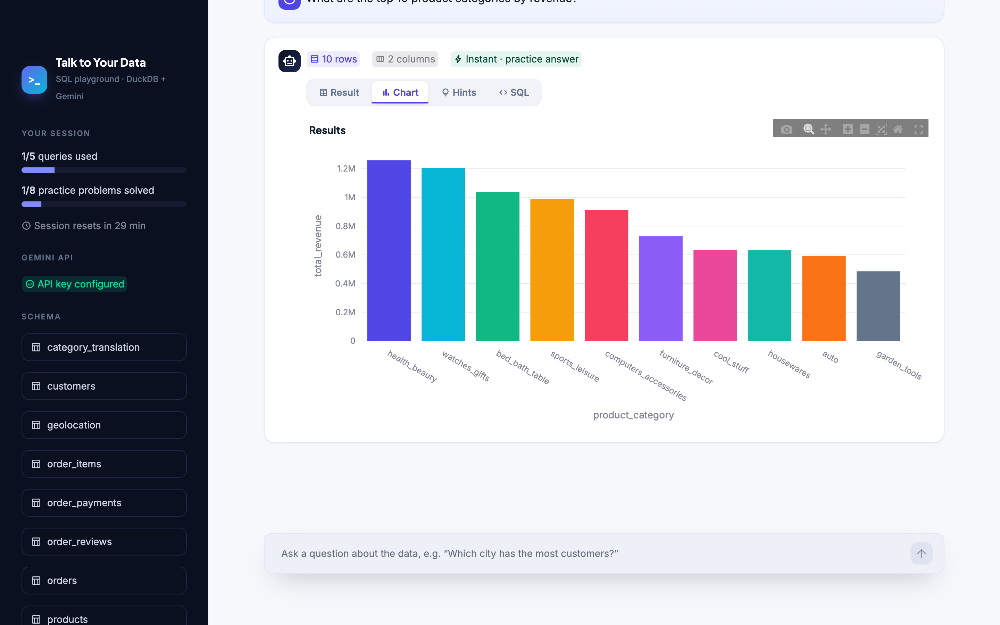
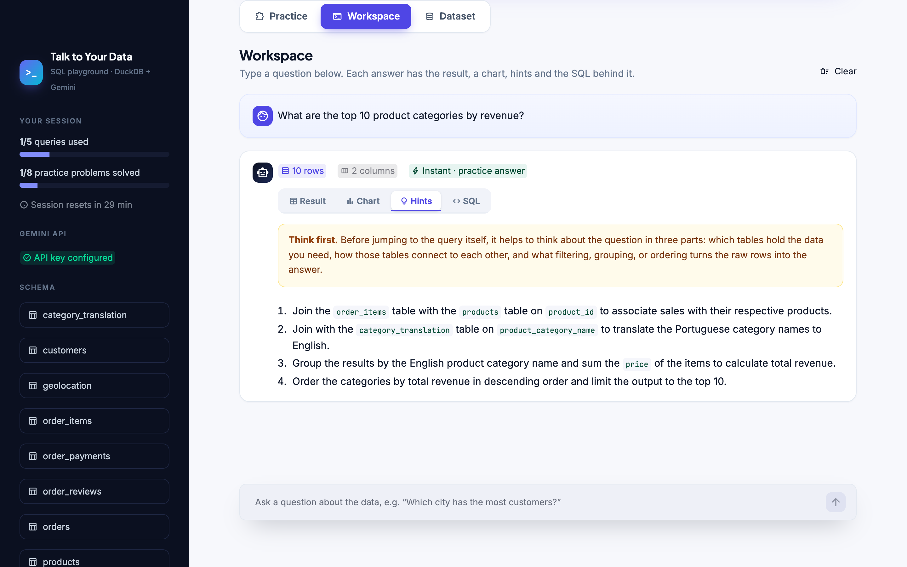
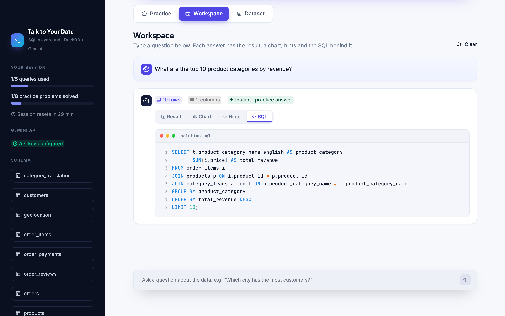
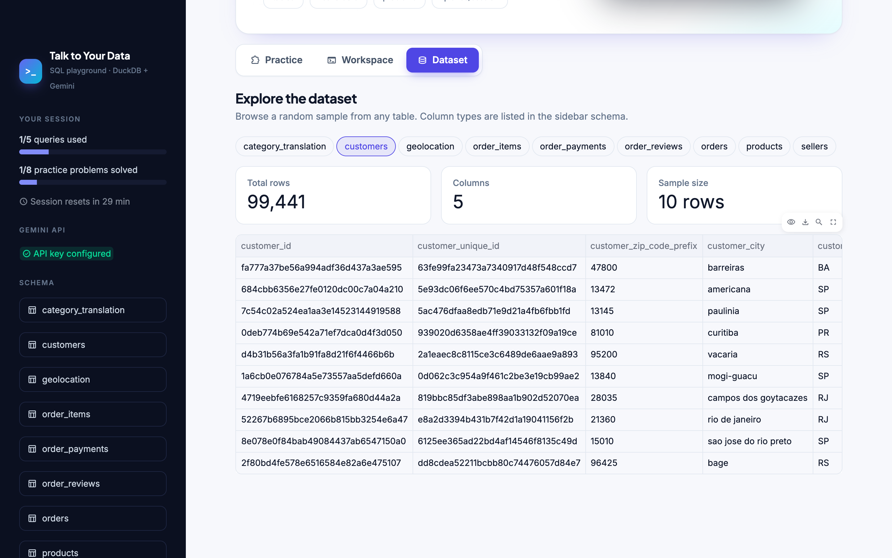

# Talk to Your Data 💬

**Learn SQL by asking questions in plain English.**

Type a question like *"What are the top 10 product categories by revenue?"* and the app writes the SQL query for you, runs it on a real e-commerce database, and shows you the answer as a table and a chart. It also explains *how* the query works, step by step, so you learn the pattern instead of just copying it.

It's a small playground for practicing SQL. You don't need to set up a database or know SQL to start. Built with Streamlit, DuckDB, and Google's Gemini API.



## A quick tour

### 1. Pick a practice problem

Start on the **Practice** tab. There are 8 ready-made problems, tagged **Easy**, **Medium**, or **Hard**. Each card shows the SQL ideas it teaches (like `GROUP BY` or `JOIN`) and the tables it uses. Click **Solve** to see the answer. Practice problems run instantly and don't need an API key.



### 2. See the result

Your question and its answer appear in the **Workspace**. The answer opens as a table, and four tabs let you look at it in different ways: **Result**, **Chart**, **Hints**, and **SQL**.



### 3. Look at the chart

The app picks a chart that fits the data: bar, line, pie, or scatter.



### 4. Read the hints first, then the SQL

**Hints** walks through the logic in plain English: which tables to use, how they connect, and how to filter, group, or sort the rows. Try to write the query yourself from the hints, then open **SQL** to compare with the solution.

<table>
  <tr>
    <td></td>
    <td></td>
  </tr>
</table>

### 5. Ask your own question

Type any question about the data in the box at the bottom of the Workspace. Gemini turns it into SQL, and you get the same result, chart, hints, and SQL tabs. (Your own questions need a Gemini API key; see [Setup](#setup).)

### 6. Explore the data

The **Dataset** tab lets you browse a sample of rows from any of the 9 tables. The sidebar lists every table's columns and their types, which helps when you're writing your own queries.



## Good to know

- **5 queries per session.** The session resets automatically after 30 minutes. This keeps API usage in check on the public demo. The sidebar shows how many queries you have left.
- **Read-only.** Only `SELECT` queries run, so nothing can change or delete the data.
- **Progress tracking.** Solved practice problems get a ✓ badge, and the sidebar counts how many you've finished.

## How it works

1. You ask a question (or click a practice problem).
2. Gemini reads the database schema and writes a DuckDB SQL query that answers it. Practice problems use pre-generated queries instead, so they skip this step.
3. The query runs against a local DuckDB database.
4. The app shows the result as a table, picks a chart, and adds the hints and the formatted SQL.

## Dataset

Real data — the [Olist Brazilian E-Commerce dataset](https://www.kaggle.com/datasets/olistbr/brazilian-ecommerce) from Kaggle (9 tables: customers, orders, order_items, order_payments, order_reviews, products, sellers, geolocation, category translations; ~100K orders spanning 2016–2018). [seed_data.py](seed_data.py) downloads it via `kagglehub` and loads it into DuckDB on first run — no Kaggle account needed.

## Tech stack

- [Streamlit](https://streamlit.io) — UI
- [DuckDB](https://duckdb.org) — local analytical database
- [Google Gemini](https://ai.google.dev) — natural language → SQL
- [Plotly](https://plotly.com/python/) — charts

## Setup

### Prerequisites

- Python 3.10+
- A [Google Gemini API key](https://aistudio.google.com/apikey) (free tier works — needed for your own questions; the practice problems work without one)

### 1. Clone and install dependencies

```bash
git clone https://github.com/ahfaisal122/talk-to-your-data.git
cd talk-to-your-data
python3 -m venv .venv
source .venv/bin/activate   # Windows: .venv\Scripts\activate
pip install -r requirements.txt
```

### 2. Add your API key

Pick one:

**Option A — Streamlit secrets file (recommended for local dev)**

```bash
cp .streamlit/secrets.toml.example .streamlit/secrets.toml
```

Then edit `.streamlit/secrets.toml` and paste your key in place of `"..."`:

```toml
GOOGLE_API_KEY = "your-key-here"
```

**Option B — environment variable**

```bash
export GOOGLE_API_KEY="your-key-here"
```

`.streamlit/secrets.toml` is git-ignored, so your key never gets committed.

### 3. Run the app

```bash
streamlit run app.py
```

Opens at `http://localhost:8501`. On first run, the app downloads the Olist dataset and loads it into a local `ecommerce.duckdb` file — this takes 30–60 seconds; subsequent runs reuse the cached file.

No API key yet? You can still try the 8 practice problems — their SQL is pre-generated and cached in [sample_cache.json](sample_cache.json), so they run instantly without calling Gemini.

### Run in GitHub Codespaces

This repo includes a `.devcontainer` config, so you can also open it in a Codespace and it'll install dependencies and launch `streamlit run app.py` automatically — just add your API key via Codespaces secrets or `.streamlit/secrets.toml` first.

## Project structure

```
.
├── app.py                    # Streamlit UI: practice problems, workspace, dataset explorer, session limits
├── query_engine.py           # DB access, Gemini prompt + SQL generation, auto-charting
├── seed_data.py               # Downloads the Olist dataset via kagglehub and loads it into DuckDB
├── generate_sample_cache.py  # One-off script that pre-generates SQL for the practice problems
├── sample_cache.json         # Cached SQL/explanations for the practice problems
├── requirements.txt
├── .streamlit/
│   ├── config.toml               # Theme + server settings
│   └── secrets.toml.example      # Template for your local API key
└── .devcontainer/             # GitHub Codespaces / VS Code dev container config
```


